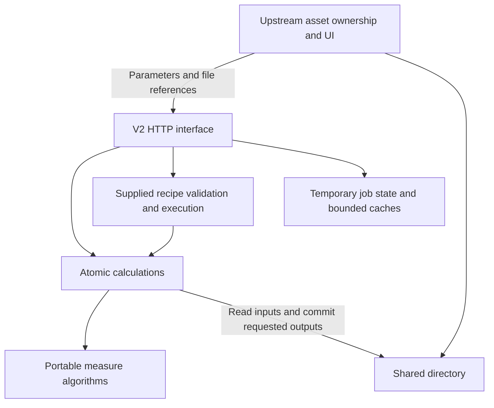

# Measurement API V2 rewrite proposal

Date: 2026-10-05. Status: proposed design, not an implemented contract.

## Confirmed scope and ownership

This revision supersedes the earlier HTTP-upload/engine-owned asset proposal.

- Replace the existing V2 implementation and public contract completely.
  Retain /api/v2 as the route prefix, not the old session/model lifecycle.
- Upstream owns recipe, template and calibration assets, their persistence,
  versions, metadata, publication and deletion.
- Both services run on the same node. HTTP carries control parameters, compact
  results and file paths. Shared directories carry images/templates and other
  large input/output files.
- The user requires FastAPI for the new V2 HTTP server. Use Pydantic v2 for
  typed request/response contracts and Uvicorn for ASGI serving.
- V2 provides atomic calculations, supplied-recipe validation/preview, and
  complete multi-target execution. It has no authoritative business asset store.
- Temporary job state and decoded/prepared caches are allowed. They must not
  become the only copy of any recipe, template, calibration or business result.
- Cover every existing user-meaningful capability, including scale/camera/
  stereo/plane calibration, correction, stitching, geometry, diagnostics,
  format conversion, exports and replay.
- Camera acquisition, business projects, permissions and acceptance rules
  remain upstream. UI actions such as zooming are not computation endpoints.

## Responsibilities and architecture



Upstream stores drafts/versions and file manifests, archives final results,
and supplies exact configuration for each call. V2 reads the requested
version, calculates, writes requested outputs and returns provenance. It never
looks up a latest recipe or replaces an upstream-owned asset.

Template building and calibration generate new files under a requested output
directory. After successful completion, upstream registers those files in its
own asset system. There are no V2 recipe/template/calibration CRUD or
publication endpoints. The recipe runner invokes the same atomic functions
directly, so upstream need not reimplement DAG or multi-target orchestration.

The engine must not import measure_gui, instantiate Tk objects or invoke
interactive windows. Extract current GUI alignment, mapping and orchestration
into portable measure modules. The HTTP stack is FastAPI/Pydantic v2/Uvicorn.
Typed models and the operation registry drive validation, capability discovery
and generated OpenAPI. Existing V1 can retain its own Flask server independently.

## FastAPI HTTP implementation

- Provide a create_app(settings) application factory and APIRouter modules
  grouped by image, template, measurement, geometry, calibration, recipe,
  operation and diagnostic capabilities. All computation routes use /api/v2.
- Pydantic request/response models define field constraints, discriminated
  unions, file references, coordinate frames and sync/async response variants.
  Reject unknown fields and normalize finite numeric values at the contract
  interface. Domain calculations do not depend on FastAPI request objects.
- Generate /api/v2/openapi.json from actual typed routes, including all
  success/error responses and stable operation IDs. Serve interactive API
  documentation at /api/v2/docs. The capability endpoint reuses the same
  models/operation registry rather than duplicating parameter schemas.
- Initialize shared-root configuration, bounded caches and job workers using
  FastAPI lifespan. Shutdown stops admission, settles/cancels active jobs under
  documented policy and releases operational resources.
- Use dependency injection for configured file access and job execution.
  Route adapters validate and submit work; they do not contain metrology logic.
- Keep CPU-heavy OpenCV/NumPy measurement in bounded isolated processes.
  Async route handlers must not execute those calculations, large file reads
  or digest computation on the ASGI event loop. File inspection/snapshot work
  uses bounded offloaded execution where needed. Synchronous computation
  requests await the same job execution path as asynchronous requests.
- Do not use FastAPI BackgroundTasks as the measurement scheduler: computation
  requires admission limits, queryable state, deadlines and cancellation.
- Run one Uvicorn ASGI worker initially, with separate bounded CPU workers.
  Increasing ASGI worker count requires explicit shared operation routing/state
  and resource budgets; do not accidentally create independent job registries.
- Unified exception handlers translate validation, file, domain and execution
  errors into the documented envelope. Malformed JSON returns 400; schema or
  parameter validation returns 422, including Pydantic validation details.
- Declare and lock compatible FastAPI/Pydantic/Uvicorn dependencies during
  implementation. Test the declared Python runtime and application lifecycle.

Proposed startup after implementation:

```bash
uvicorn measure_api.v2.app:create_app --factory --host 0.0.0.0 --port 9004 --workers 1
```

The factory loads validated settings when no settings are injected. The
python -m measure_api.v2 entry point invokes the same ASGI application/startup
configuration; it does not introduce another HTTP implementation.

## Data contracts and resource ownership

| Data | Authoritative owner | V2 responsibility |
| --- | --- | --- |
| Recipe/draft/version | Upstream | Validate and execute supplied JSON/file |
| Template | Upstream | Build, inspect, match supplied files |
| Calibration | Upstream | Compute, validate and apply supplied values/files |
| Image | Upstream | Read immutable snapshots and decode temporarily |
| Final result/diagnostics | Upstream after completion | Return JSON and write requested files |
| Operation metadata | V2 within operational retention | Query/cancel admitted work |
| Replay manifest | Upstream | Recompute supplied frozen request/files |

Upstream IDs and versions are echoed as provenance, not mandatory
engine-registered lookup keys. Recipe node IDs are stable and independent of
labels. Target IDs are local to one run, not identities across frames.

Each generated file descriptor includes path, kind, schema version, hash and
size. Image metadata additionally includes decoded shape, dtype, color model
and coordinate frame. Source capture metadata is echoed when supplied.

## Shared-directory exchange protocol

There is no required HTTP upload, image registration or permanent image_id.
The canonical reference is a configured root alias plus relative path:

```json
{
  "root": "exchange",
  "path": "inputs/frame_001.png",
  "sha256": "<actual-content-sha256>"
}
```

Aliases map to local absolute directories. The same volume may be mounted
at /data/measure upstream and /srv/measure in V2 without changing requests.
An absolute-path descriptor can also be supported when mounts match, provided
the resolved path stays inside configured shared roots. These are schema oneOf
forms; do not mix absolute and root-relative fields.

Example upstream-controlled layout:

```text
exchange/
  inputs/<capture-id>/image.png
  templates/<asset-id>/<version>/manifest.json
  templates/<asset-id>/<version>/pixels.npy
  calibrations/<asset-id>/<version>/calibration.json
  recipes/<recipe-id>/<version>/recipe.json
  outputs/<request-id>/<attempt-id>/
```

File lifecycle:

1. Upstream writes inputs to temporary paths, then atomically renames completed
   files before submitting HTTP. Input versions remain immutable while used.
2. For multi-file template assets, publish the manifest last, after all payloads.
3. V2 snapshots parameters and either privately copies/decodes files or pins
   verified immutable file references for the accepted operation.
4. V2 writes to staging files in the requested output filesystem, closes them,
   atomically renames completed files and commits a multi-file result manifest
   last. Partial outputs are never advertised as complete.
5. Upstream receives completed file metadata, registers/archives results and
   controls final retention. It keeps inputs available until terminal state.
6. V2 cleans only its own unfinished staging files, cache and expired job
   records. It does not delete upstream inputs or completed assets.

Path checks cover configured root, canonical path and symlink destination.
Report missing/unreadable inputs, hash mismatch, in-place modification and
unwritable/conflicting outputs distinctly. Attempt directories are isolated;
never overwrite an input or an existing completed asset.

GRAY8 and RGB/BGR8 PNG/JPEG match initial algorithm support. Prefer lossless
images for precision fixtures. Unsupported depth conversion is explicit.
Float preprocessing results use typed numeric files; normalized 8-bit browser
previews are separate optional artifacts.

Caches are bounded and keyed by verified content digest, algorithm version
and parameters. Path, upstream ID or mtime alone cannot establish identity.
Supplied hashes are verified before trusted reuse. Cache misses recompute;
restart cannot make upstream files unusable. No shared-memory pool is required.

## Coordinate, unit, and geometry contract

1. Public 2D points use `{x, y}`: x increases right, y increases down, origin is
   the center of the top-left pixel. x equals internal col; y equals internal row.
   No public positional arrays with ambiguous row/col order.
2. Public probe and pose angles are degrees: 0 points right, 90 points down,
   positive rotation is visually clockwise in image coordinates. Adapters
   convert the existing OpenCV and internal radian conventions explicitly.
3. ROI extents have descriptive names: `search_half_length_px` along a probe,
   `average_half_width_px` perpendicular to it; rotated boxes use full
   `width_px` and `height_px`. Do not expose ambiguous length1/length2 semantics.
4. Every geometric result identifies its `frame_id` and unit. A line satisfies
   `a*x + b*y + c = 0` with normalized `(a,b)`. A distance has a declared metric
   frame; an angle explicitly states signedness and supported range.
5. A transform declares `from_frame`, `to_frame`, transform type and homogeneous
   3x3 matrix applied to `[x,y,1]`. Undistortion is a nonlinear camera mapping,
   not a fictitious affine matrix. Derived images retain the full mapping chain.
6. Point/line/circle scalar outputs are computed in the requested measurement
   frame, not inferred from a display-normalized patch. Default is the source
   image pixel frame; millimeters require an applicable calibration.
7. Alignment may normalize scale for matching and sampling. Extracted edges
   must be mapped to the declared metric frame before fitting and calculating
   dimensions, so a physically larger target remains measurably larger.
8. A scale calibration applies to its camera/setup, image geometry and declared
   working-plane assumptions. Intrinsics alone do not establish mm conversion;
   perspective physical measurements require a calibrated plane mapping.
9. A circle transformed by a general affine/projective mapping is not generally
   a circle. Preserve it as a sampled overlay curve when rendering; refit mapped
   edge samples in the measurement frame when circle measurement is requested.
   Reject unsupported analytical circle conversions instead of retaining a
   misleading radius. Similarity transforms can scale radius analytically.
10. Return raw pixel dimensions and requested physical dimensions separately,
    with upstream calibration version/digest and units. No implicit mutation of pixels into mm.

## Atomic endpoint catalog

All paths have the /api/v2 prefix. Compute endpoints share the execution
envelope below. No calculation requires project/session/asset registration.

### Discovery and image operations

| Method and path | Purpose |
| --- | --- |
| GET /health/live; GET /health/ready | Liveness and shared-root/worker readiness |
| GET /capabilities | Operations, node schemas, defaults, formats, modes and limits |
| GET /openapi.json | Generated complete request/response contract |
| POST /image-inspections | Read supplied image and return decoded metadata/hash |
| POST /image-previews | Generate preview file in requested output directory |
| POST /image-preprocessings | Raw/Canny/Sobel/CLAHE/threshold calculation |
| POST /image-crops | Crop/straighten; return output file and transforms |

No required binary upload/download endpoints. Browser access to shared files is
provided by upstream. Small metadata/overlays stay JSON; large arrays/images
are returned as shared-file references.

### Templates and alignment

| Method and path | Purpose |
| --- | --- |
| POST /template-builds | Build template from supplied image/ROI/anchor/preprocessing; write portable shared files |
| POST /template-inspections | Validate supplied template manifest/files and return metadata |
| POST /template-matches | One or multiple matches, search ROI, score/polarity options, angle/scale search, NMS and pyramid options |
| POST /transforms/similarity-estimates | Estimate translation/similarity from explicit point correspondences |
| POST /alignments/rigid | Apply one target pose and crop; return patch and mappings |
| POST /alignments/control-points | Match local control templates and refine alignment for one target |
| POST /geometry/transforms | Map typed points/lines/geometry between declared frames |

The current GUI parent matcher uses a square context template around the ROI.
The new template contract must expose `support_mode=roi|square_context` so
parity and a tighter ROI-based matcher are deliberate choices. Actual taught
support and anchor must be returned. Rectangular/rotated support that the
current TemplatePoint cannot express requires a tested core enhancement.

Control-point refinement initially supports the implemented similarity model,
with minimum accepted matches, RANSAC threshold, residuals, and explicit
`fallback=error|rigid` policy. Do not advertise unrestricted affine precision
from `estimateAffinePartial2D`. Multi-target refinement requires independently
cropped per-target control search regions and its own grouping tests.

### Edge measurement and fitting

| Method and path | Purpose |
| --- | --- |
| POST /edge-profiles | Probe gray/smoothed/gradient curves and sample-coordinate mapping for UI debugging |
| POST /measurements/edge-points | All or selected edge points, amplitudes and confidence diagnostics |
| POST /measurements/edge-pairs | Boundary pairs, both endpoints, center and explicit width |
| POST /measurements/lines | Image-based multi-probe line detection and fitting |
| POST /measurements/circles | Image-based radial/arc probing and circle fitting |
| POST /measurements/template-points | Local feature-template localization using supplied template files |
| POST /geometry/lines:fit | Fit a line to client-supplied points; no image required |
| POST /geometry/circles:fit | Fit a circle to client-supplied points; no image required |
| POST /measurement-batches | Several independent typed measurements sharing one image; per-item results without creating a recipe |

Image-based fits expose probe count, search extents, interpolation, sigma,
threshold unit, transition polarity, expected geometry, circle radial limits
and arc range. Quality includes requested/successful probe counts, selected
edge amplitudes, mean/max residual, and RMS calculated from actual residuals.
Do not substitute zeros for unavailable quality metrics.

Atomic edge-pair output can contain several pairs. Recipe nodes select a pair
explicitly or declare array outputs. The ordinary single-pair node has named
ports `edge_a`, `edge_b`, `center`, and `width`; these ports replace magic
`label_A`/`label_B` dependencies. No pairs is a domain-invalid result, not a
fabricated zero-width measurement.

### Composed geometry and existing business metrics

| Method and path | Purpose |
| --- | --- |
| POST /geometry/two-point-lines | Line through two points |
| POST /geometry/point-distances | Euclidean distance between two points |
| POST /geometry/point-line-distances | Perpendicular distance to an infinite line |
| POST /geometry/line-angles | Smaller unsigned angle, preserving existing 0-90 degree semantics |
| POST /geometry/point-circle-distances | Shortest distance to circumference |
| POST /geometry/circle-dimensions | Derive radius, diameter and sampled radial spread |
| POST /geometry/length-conversions | Explicit px/mm conversion under a scale calibration |
| POST /evaluations/ranges | Inclusive limit checks with explicit units and invalid-value policy |
| POST /evaluations/diameter-variation | Existing multiple-diameter range/variation metric |
| POST /evaluations/centerline-deviation | Existing edge-pair-center x-range metric |

Geometry requests require compatible frames or an explicit supported mapping.
They accept typed geometry values directly, so upstream code can compose
operations without a saved recipe. Business metric operations expose current
script functionality as pure calculations; threshold selection and product
acceptance remain upstream-owned. The existing centerline-deviation metric is
named for its computation, not certified geometric verticality. Circle radial
spread is not described as an ellipse fit or standardized roundness result.

### Calibration, camera mapping, and stitching

| Method and path | Purpose |
| --- | --- |
| POST /calibration-features/checkerboard-corners | Detect/refine corners inside optional ROI with lattice diagnostics |
| POST /calibrations/scales | Compute scalar mm/px from supplied/manual corners and known square size |
| POST /calibration-features/dot-grids | Detect dot-grid points per image for review/exclusion before calibration |
| POST /calibrations/cameras | Compute intrinsics/distortion from images or accepted point observations |
| POST /image-undistortions | Apply intrinsic calibration and return corrected image/mapping metadata |
| POST /calibrations/plane-mappings | Board-plane mappings for camera pair and shared physical canvas |
| POST /calibrations/stereo-rigs | Relative pose from paired observations using fixed intrinsics as specified |
| POST /calibration-validations | Validate supplied calibration against board observations; return per-point errors |
| POST /calibration-origin-adjustments | Compute revised mapping and write an output file; upstream registers it |
| POST /image-stitches | Undistort/warp A and B to a calibrated shared plane canvas |
| POST /geometry/stereo-transforms | Transform 3D points between calibrated camera frames |
| POST /geometry/camera-projections | Project supplied 3D points into a calibrated camera image |
| POST /calibration-inspections | Inspect supplied calibration values/files |
| POST /calibration-exports; POST /calibration-imports | Convert supplied calibration values/files into portable shared output files |

Camera calibration from edited point observations is a new interface built on
the existing algorithm; point ordering, physical board coordinates, image
dimensions, camera association and rejected images must be explicit.
Stereo input pairs must be paired by capture identity, never by incidental
list order. Board-plane stitching and 3D projection do not imply arbitrary
3D object reconstruction or surface-length measurement.

### Visualization, diagnostics and replay

| Method and path | Purpose |
| --- | --- |
| POST /visualizations | Vector overlays; optional raster output file |
| POST /result-exports | Generate CSV/JSON from supplied results or a result file |
| GET /operations; GET /operations/{id} | Temporary operation state/result, bounded long poll |
| GET /operations/{id}/diagnostics | Retained stage timing and output-file metadata |
| GET /traces/{trace_id} | Retained request hash/runtime diagnostics |
| POST /operations/{id}:cancel | Cancel accepted work |
| POST /replays | Recompute supplied archived request manifest and input files |

Vector overlays support upstream selection/hiding without recomputation.
Operational IDs expire under documented retention. Upstream archives permanent
results and traces; replay accepts archived manifests even after the old
operation expires. It recomputes in isolation and does not replay historical
delete/publication actions. Runtime versions and file hashes are recorded;
exact replay requires the compatible runtime and unchanged retained inputs.

## Recipe validation, preview and execution

| Method and path | Purpose |
| --- | --- |
| POST /recipe-validations | Validate supplied JSON/file, schemas, frames, files, ports and DAG |
| POST /recipe-previews | Run supplied draft or selected nodes plus dependency closure |
| POST /runs | Execute supplied frozen recipe and image file references |
| POST /run-batches | Per-image outcomes for a supplied recipe |
| POST /recipe-exports | Package supplied recipe/assets into shared output files |
| POST /recipe-imports | Decode package into configuration/files; upstream registers them |
| POST /legacy-project-conversions | One-way conversion of supported GUI project/NPZ files |

Requests accept exactly one of inline recipe or recipe_ref. Template and
calibration references use shared files or small inline typed values, not V2
asset IDs. Full runs return resolved configuration hash and upstream version.

There is no /recipes CRUD, version publication, permanent /runs/{id} business
result store, asset DELETE API or engine recipe database. Upstream handles
those lifecycle operations.

Recipe configuration includes image corrections, parent matching/fixed ROI,
alignment, metric frame/calibration, target selection, required outputs, nodes
and optional upstream-supplied evaluation rules. Each stage is separately
callable. Nodes use stable node_id, label, parameters, enabled state and named
input/output ports. Inputs reference {node_id, port}; display order is separate.

Upstream edits the recipe and submits a snapshot. Validation returns cycles,
missing references, incompatible frames/ports, stale templates and dependency
impact information. Disabled required dependencies are explicit errors.
Unsaved previews carry upstream revision and preview token, echoed so upstream
can discard out-of-order responses. V2 does not save or modify the recipe.

Whole-run sequence:

1. Read/snapshot supplied configuration and immutable files.
2. Apply declared camera correction or stitching.
3. Match parent templates or use a fixed ROI.
4. Align each target and return mappings.
5. Extract samples, map to metric frame and fit geometry.
6. Execute composed nodes in DAG order; propagate invalid dependencies.
7. Compute requested physical outputs with supplied calibration provenance.
8. Evaluate explicit rules.
9. Commit requested result/diagnostic files; return compact JSON/file manifest.

## Example: edge-pair preview

Upstream first commits the image file, then submits:

```http
POST /api/v2/measurements/edge-pairs
```

```json
{
  "image": {"root": "exchange", "path": "inputs/frame_001.png"},
  "roi": {
    "center": {"x": 500.0, "y": 300.0},
    "angle_deg": 0.0,
    "search_half_length_px": 120.0,
    "average_half_width_px": 8.0
  },
  "detector": {
    "sigma_px": 1.0,
    "threshold": {"value": 10.0, "unit": "gradient_gray8"},
    "transition": "all",
    "selection": "outermost",
    "interpolation": "linear"
  },
  "measurement_frame": {"type": "source_image"},
  "diagnostics": {"profiles": true, "overlays": true},
  "output": {"root": "exchange", "directory": "outputs/preview_001/attempt_01"},
  "execution": {"mode": "sync", "timeout_ms": 2000}
}
```

Illustrative result, with generated file metadata abbreviated:

```json
{
  "status": "succeeded",
  "trace_id": "trace_01",
  "result": {
    "measurement_status": "valid",
    "frame_id": "source_frame_001",
    "pairs": [{
      "edge_a": {"x": 440.5, "y": 300.0},
      "edge_b": {"x": 558.5, "y": 300.0},
      "center": {"x": 499.5, "y": 300.0},
      "width": {"value": 118.0, "unit": "px"}
    }],
    "artifacts": [{
      "kind": "edge_profile",
      "file": {
        "root": "exchange",
        "path": "outputs/preview_001/attempt_01/profile.json"
      }
    }]
  }
}
```

Example full-run control request:

```json
{
  "recipe_ref": {
    "root": "exchange",
    "path": "recipes/body_width/v3/recipe.json"
  },
  "provenance": {"recipe_id": "body_width", "recipe_version": "v3"},
  "image": {"root": "exchange", "path": "inputs/frame_001.png"},
  "output": {"root": "exchange", "directory": "outputs/run_001/attempt_01"},
  "execution": {"mode": "async", "timeout_ms": 10000}
}
```

Files may include expected hashes to pin versions. The example recipe version
is upstream metadata, not a V2-published version or a latest-version lookup.

## Execution, failure and concurrency

- execution.mode=sync|async uses the same compute path. Async returns 202 and
  operation_id; sync wait expiry also returns the queryable running operation.
- States are queued, running, cancelling, succeeded, failed, cancelled and
  timed_out. Queue time counts toward the deadline; terminal state is stable.
- Bounded CPU subprocesses control concurrency and memory. Parameters are
  snapshotted and per-run mutable object state is never shared.
- Idempotency-Key can deduplicate within documented operational retention.
  Scope includes caller/route and canonical request with verified file digests.
  Changed input with the same key conflicts. This is not permanent exactly-once
  business execution; upstream records final results and retries deliberately.
- Outputs commit atomically; manifest is the multi-file completion marker.
  Cancellation before commit discards staging work. A completed commit remains
  succeeded and is not relabeled cancelled.
- V2 job metadata can use a small local journal/SQLite implementation. Restart
  marks interrupted work worker_interrupted rather than silently rerunning
  file-writing calls. Operational durability does not imply asset ownership.
- Upstream keeps input files until terminal state and controls final deletion.
  Completed output paths cannot be silently overwritten on a retry.
- Temporary job/trace query retention and cache quotas are documented and
  configurable. No recipe/calibration/template retention policy is imposed by V2.

| Status | Meaning |
| --- | --- |
| operation.status | Did calculation complete? |
| measurement_status / node validity | Are observations usable? |
| evaluation.status | pass/fail/not_evaluated/indeterminate under supplied rules |

Invalid edges/matches/dependencies produce typed reasons, never fabricated zero
measurements or old results. Target validity is derived from required outputs;
unrelated targets continue. No matches yields no_targets, with acceptance
interpreted using supplied expected-target rules.

Errors include code, message, field path/details, trace_id and retryability.
Use 400 for malformed input, 404 for missing files/jobs, 410 for expired job
records, 409 for digest/output/idempotency conflicts, 422 for invalid algorithm
configuration and 429/503 for capacity/readiness. Separate input_unreadable,
input_changed, hash_mismatch and output_write_failed. Domain-invalid
measurements remain completed typed results.

## GUI-equivalent upstream integration

| Interaction | Interface sequence |
| --- | --- |
| Load image | Upstream commits shared file; optional inspection |
| Draw/rotate ROI | Local graphics, crop preview, template build |
| Tune matching | Template-match or supplied-draft preview |
| Add/edit measurement | Atomic preview; upstream edits recipe |
| Compose dimensions | Named-port geometry preview; upstream stores dependency |
| Edit calibration corners | Detect once, edit locally, compute scale from points |
| Configure controls | Build local templates; preview target alignment |
| Hide/reorder tools | Upstream display metadata; separate node enabled state |
| Save/open/version | Upstream persistence and optional validation |
| Run measurement | Supplied frozen recipe/file plus image references |
| Review/export/replay | Structured JSON, shared artifacts and archived manifest |

## Code organization

```text
measure/
  measure1D.py, measure2D.py, measure_template.py, ...
  geometry.py          # typed geometry and mappings
  alignment.py         # crop/control refinement
  execution.py         # atomic calculations
  recipe.py            # supplied configuration and DAG execution
measure_api/v2/
  __main__.py
  app.py               # FastAPI application factory, lifespan and handlers
  http/                # FastAPI APIRouter endpoint adapters
  schemas/             # Pydantic v2 models and operation registry
  application.py       # computation orchestration
  files.py             # shared roots, input snapshots, output commits
  formats.py           # upstream-owned portable asset formats
  jobs.py              # admission/workers/cancellation
  cache.py             # disposable decoded/prepared caches
  diagnostics.py       # manifests, traces, replay
```

Source extraction: [probes](../measure/measure1D.py#L131),
[fits](../measure/measure2D.py#L166),
[templates](../measure/measure_template.py#L256),
[DAG](../measure/measure_workflow.py#L2026),
[GUI execution](../measure_gui/multi_target.py#L2316),
[alignment](../measure_gui/alignment.py#L355),
[mapping](../measure_gui/utils.py#L60),
[scale](../measure/pixel_calibration.py#L174),
[camera/stereo](../measure/measure_calibration.py#L393),
[diameter](../scripts/bottle_diameter_measurement.py#L150) and
[centerline metrics](../scripts/bottle_verticality_measurement.py#L83).

## Mandatory corrections before exposing existing behavior

First add focused numerical regressions for these integration cases, then
modify the algorithm implementation. Preserve known-good primitive behavior
while correcting coordinate and orchestration defects.

1. Normalize all line coefficients/point coordinates and add a regression for
   fitted-line plus point-distance integration; current horizontal-line case
   returns about 100.5 px instead of 40.5 px.
2. Correct matrix direction names and return explicit source/target frames.
3. Remove duplicated GUI MultiTargetWorkflow behavior from the engine dependency
   path; implement one shared measurement/composition execution path.
4. Correct control-point teaching and refinement initialization independently
   of broken GUI callbacks; verify every control template is actually built.
5. Fix edge-pair selection semantics: first/last selection must not truncate
   edges before pairing; outermost selection and polarity behavior need tests.
6. Clear per-run object state and invalidate exceptions without retaining old
   successful results. Propagate composed failures to required target validity.
7. Separate display order/visibility from execution dependencies/enabled state.
8. Compute diagnostic counts/residuals from real measurements, not incomplete
   legacy metadata. Avoid claiming quality fields the algorithms never compute.
9. Preserve dimensions across scale-normalized localization and transformed
   patches; map samples before fitting in the requested metric frame.
10. Import legacy GUI artifacts one way, with explicit convention conversion,
    unsupported-field reports and numerical fixture validation. New public
    packages use JSON plus numeric/image payloads without arbitrary pickle.

## Implementation phases and completion gates

| Phase | Deliverable | Gate |
| --- | --- | --- |
| 0: Contract | Capability catalog, shared-file formats, OpenAPI/examples | No prior asset registration needed |
| 1: Core | Pure atomic functions, geometry/ports, mandatory fixes | Numerical regressions and no GUI dependency |
| 2: Atomic interface | File handling, templates, images, probes/fits/geometry | HTTP parameters plus shared files complete teaching |
| 3: Recipe runner | Supplied-config validation/preview, DAG/multi-target execution | Upstream frozen versions execute without engine recipe store |
| 4: Full coverage | Calibration/stitching/metrics/diagnostics/export/replay | All existing meaningful capabilities callable |
| 5: Replacement | Remove old V2 handlers/contracts, update startup/docs | Upstream integration and precision/performance acceptance |

All phases are required by full rewrite scope. Existing GUI/V1 can remain
usable during development but are not V2 dependencies. Legacy project conversion
outputs files for upstream to register; it is not engine model publication.

## Verification

- Schemas/OpenAPI, formats, coordinate frames/units and every operation.
- FastAPI lifespan/dependency injection, generated OpenAPI and normalized
  validation errors; ASGI request tests cover sync/async dispatch and readiness.
- Numerical truth for edges/widths/fits/distances/angles and calibration.
- DAG ports, missing/cyclic/disabled dependencies, label changes and failures.
- Translated/rotated/scaled/multiple targets, control refinement and size
  preservation after normalized localization.
- Root aliases and differing mounts, absolute-path validation, missing and
  changed files, digest checks, symlinks, concurrent reads and output writes.
- Atomic rename, manifest-last commits, retry/output conflict, cleanup
  ownership, cancellation at commit, restart and cache identity/eviction.
- Camera/stereo/plane observation ordering, edits, rejection and mapping.
- GUI-equivalent upstream teaching/execution/CSV/replay using HTTP parameters
  and shared files only.
- Actual camera fixtures define precision/repeatability and workload defines
  latency/concurrency/memory targets; unit tests do not establish those limits.

## Remaining deployment inputs

Confirmed: upstream asset ownership, same-node deployment, HTTP parameters/
file paths, shared-directory large-file exchange and FastAPI HTTP serving.

Implementation still needs configured shared roots/mount paths, input/output
permissions, supported asset formats, camera resolution, target count,
concurrency/latency requirements and operation retention. These configure the
agreed design rather than change ownership or introduce asset CRUD.

No production source changes or old V2 deletion were performed in this revision.
