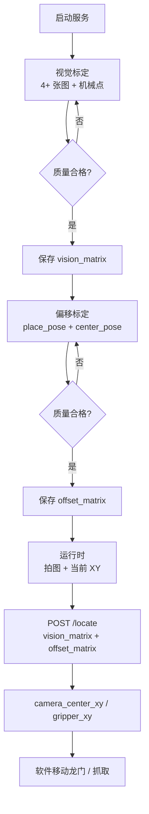

# 龙门相机抓取模块说明（Pick API）

> 面向同事的模块介绍：解决什么问题、现场怎么标定、三个接口怎么调、debug 产物在哪里、边界是什么。
>
> 接口速查：[`PICK_API.md`](PICK_API.md)
>
> 代码入口：[`measure/pick_api.py`](../measure/pick_api.py)、[`measure_api/pick_server.py`](pick_server.py)

---

## 0. 一句话

三轴龙门上，相机和夹爪不在同一个点。这个模块通过两次标定，把图像里的目标位置换算成两个机械坐标：

- `camera_center_xy`：把**相机中心**移到目标上时，法兰应该在哪；
- `gripper_xy`：把**夹爪**移到目标上时，法兰应该在哪。

每次标定只返回一个 **3×3 齐次矩阵**：

- 视觉标定返回 `vision_matrix`；
- 偏移标定返回 `offset_matrix`。

软件保存这两个矩阵，定位时把它们和当前法兰 XY 一起传给 `/locate`。服务端**不保存配方**，不直接和机器人/PLC 通信，也不处理 Z。

---

## 1. 系统组成

| 文件 | 作用 |
|---|---|
| `measure/pick_api.py` | 纯计算核心：`GantryPick`、`TargetLocation`、矩阵校验 |
| `measure/pick_artifacts.py` | debug run 目录、标注图、manifest、ZIP、保留清理 |
| `measure_api/pick_server.py` | FastAPI 服务：3 个业务接口 + debug 开关 + 产物读取 |
| `measure/pick_replay.py` | 离线复现 CLI |
| `measure_api/PICK_API.md` | 精简接口契约 |
| `tests/test_pick_api.py` | 核心矩阵/定位测试 |
| `tests/test_pick_artifacts.py` | 落盘/标注测试 |
| `tests/test_pick_server.py` | HTTP 接口测试 |

服务是**无状态**的：没有 `pick_recipe.json`，也没有 `/status`。

---

## 2. 坐标与矩阵约定

### 2.1 基本约定

| 项目 | 约定 |
|---|---|
| 图像坐标 | `(u, v) = (col, row)`，像素 |
| 机械坐标 | `(X, Y)`，单位与控制器一致，通常 mm |
| Z 轴 | **完全忽略**；请求带 3 个数也只取前两个 |
| 图像中心 | `((W-1)/2, (H-1)/2)`，标定和定位共用 |
| 目标 | 圆形目标；默认半径 6–3000 px；一张图一个目标（最高置信度） |
| 分辨率 | 矩阵只在标定分辨率下有效；换分辨率/裁剪要重标 |

### 2.2 视觉矩阵

```text
V = [[a00, a01, b0],
     [a10, a11, b1],
     [0,   0,   1 ]]
```

`/locate` 只用左上 2×2：

```text
A = V[:2, :2]
delta = A @ (image_centre - target_uv)
camera_center_xy = robot_pose + delta
```

> **第三列 `b` 只对本次标定目标所在位置成立，`/locate` 不使用它。**
> 它保留在矩阵里只为完整存档；不要用 `V @ [u,v,1]` 当任意目标的绝对坐标。

### 2.3 偏移矩阵

```text
O = [[1, 0, dx],
     [0, 1, dy],
     [0, 0, 1 ]]
```

```text
gripper_xy = camera_center_xy + (dx, dy)
```

当前偏移是纯平移，矩阵左上 2×2 固定为单位阵；如果传入带旋转的矩阵，接口会报 `400 bad_matrix`。

---

## 3. 端到端流程



### 3.1 视觉标定

1. 标定圆固定在工位上，不要动；
2. 移动相机，让标定圆出现在画面四角（建议 4 角 + 中心，共 5 点；产线建议 7~9 点）；
3. 每个位置拍一张图，记录当时的法兰 XY；
4. 调 `/calibrate/vision`，保存返回的 `matrix`；
5. 质量不合格时接口返回 422，不会给矩阵；debug 打开时看 `overview` 排查；
6. 重新拍，直到拿到矩阵。

### 3.2 偏移标定

1. 夹爪抓起标定物，放到工位上，保持不动，记录 `place_pose`；
2. 移动龙门，让相机看到目标；
3. 把目标移到画面中心：
   - 手动微调，或
   - 先用视觉矩阵调 `/locate` 拿 `camera_center_xy`，移动过去，再拍一张确认；
4. 记录实际 `center_pose`；
5. 调 `/calibrate/offset`，保存返回的 `matrix`；
6. 建议换 3~5 个位置重复，检查矩阵平移列 `dx/dy` 是否稳定。

`offset = place_pose − center_pose`，符号是**加**到相机居中位姿上：

```text
gripper_xy = camera_center_xy + offset_xy
```

### 3.3 运行时定位

1. 软件拍照；
2. 读拍照时的法兰 `(X, Y)`；
3. 带上保存的两个矩阵调 `/locate`；
4. 拿 `gripper_xy` 直接抓，或先移动到 `camera_center_xy` 再看一次；
5. Z 轴由软件自己控制。

软件侧伪代码：

```python
resp = POST /api/v1/locate          # image + robot_pose + vision_matrix + offset_matrix
if not resp["ok"]:
    raise RuntimeError(resp["error"])

move_to(resp["gripper_xy"])
# Z 由软件按工艺设置
```

---

## 4. 接口 1：视觉标定

`POST /api/v1/calibrate/vision`，`multipart/form-data`：

| 字段 | 类型 | 必填 | 说明 |
|---|---|---|---|
| `images` | 文件，重复 4+ 次 | 是 | 同尺寸；顺序与点位一一对应 |
| `robot_points` | JSON 字符串 | 是 | `[[x,y], ...]`，数量与 images 相同 |

```bash
curl -X POST http://127.0.0.1:8100/api/v1/calibrate/vision \
  -F "images=@LL.jpg" \
  -F "images=@LT.jpg" \
  -F "images=@RB.jpg" \
  -F "images=@RT.jpg" \
  -F 'robot_points=[[10.228,308.451],[26.428,309.193],[5.638,345.111],[22.058,346.681]]'
```

响应：

```json
{
  "ok": true,
  "matrix": [
    [-0.00126349, -0.01169656, 40.699445],
    [ 0.01166881, -0.00132630, 297.676806],
    [ 0.0,         0.0,         1.0]
  ]
}
```

- 标定质量不合格：422 `calibration_invalid`，不返回矩阵；
- 某张图找不到圆：422 `no_target`，带 `image_index`；
- 图片数/点位数不一致：400；
- debug 开时只额外返回 `run_id`，不返回 `rms`、`warnings`、图片 URL 等。需要看图时用 `/runs/{run_id}` 或 `/files/{run_id}/...`。

---

## 5. 接口 2：偏移标定

`POST /api/v1/calibrate/offset`，JSON：

```json
{
  "samples": [
    {"place_pose": [118.0, 89.0], "center_pose": [110.0, 85.0]}
  ]
}
```

响应：

```json
{
  "ok": true,
  "matrix": [
    [1.0, 0.0, 8.0],
    [0.0, 1.0, 4.0],
    [0.0, 0.0, 1.0]
  ]
}
```

- `samples` 至少 1 组，建议 3~5 组；
- `place_pose`：夹爪放下目标时的法兰 XY；
- `center_pose`：相机对准目标时的法兰 XY；
- 质量不合格：422 `offset_invalid`，不返回矩阵；
- debug 开时只额外返回 `run_id`。

---

## 6. 接口 3：定位

`POST /api/v1/locate`，`multipart/form-data`：

| 字段 | 类型 | 必填 | 说明 |
|---|---|---|---|
| `image` | 文件 | 是 | 当前图 |
| `robot_pose` | JSON 字符串 | 是 | 拍照时法兰 `[x,y]` |
| `vision_matrix` | JSON 字符串 | 是 | 视觉标定返回的 3×3 矩阵 |
| `offset_matrix` | JSON 字符串 | 否 | 偏移标定返回的 3×3 矩阵 |

```bash
V='[[-0.00126349,-0.01169656,40.699445],[0.01166881,-0.00132630,297.676806],[0,0,1]]'
O='[[1,0,8],[0,1,4],[0,0,1]]'

curl -X POST http://127.0.0.1:8100/api/v1/locate \
  -F "image=@shot.jpg" \
  -F 'robot_pose=[90.0,180.0]' \
  -F "vision_matrix=$V" \
  -F "offset_matrix=$O"
```

响应：

```json
{
  "ok": true,
  "camera_center_xy": [90.975, 181.975],
  "gripper_xy": [98.975, 185.975]
}
```

- 不传 `offset_matrix`：`gripper_xy` 为 `null`，`camera_center_xy` 仍可用；
- 矩阵不是 3×3、最后一行不对、奇异、偏移矩阵含旋转：400 `bad_matrix`；
- 找不到圆：422 `no_target`；
- 置信度低：422 `low_confidence`；
- debug 开时只额外返回 `run_id`。

---

## 7. Debug 与产物

全局开关：

```http
GET /api/v1/debug
PUT /api/v1/debug   {"enabled": true}
```

- 开：校准/定位生成 `data/pick_runs/<run_id>/`；
- 关：不生成任何 run 目录；
- 响应只多一个 `run_id`，不返回图片 URL；
- 开关只在内存，重启回到 `PICK_DEBUG`。

run 目录：

```text
data/pick_runs/<run_id>/
├── manifest.json          # run 元信息、文件索引、环境版本
├── inputs.json            # 原始入参；定位时含两个矩阵
├── result.json            # 矩阵/坐标 + 诊断
├── README.txt
├── overview.jpg           # 视觉标定拼图
└── images/
    ├── 00_original.jpg
    ├── 00_annotated.jpg
    └── ...
```

标注图：

- 绿圈：检测圆；红十字：圆心；
- 底部黑色信息栏：`uv`、半径、置信度、机械 XY；
- 定位图额外画蓝十字（图像中心）和“中心 → 圆心”箭头；
- 检测失败标 `NO TARGET`；
- 原图原样保存。

读取：

| 方法 | 路径 | 说明 |
|---|---|---|
| `GET` | `/api/v1/runs?limit=20` | 最近 run |
| `GET` | `/api/v1/runs/{run_id}` | manifest，含图片相对路径 |
| `GET` | `/api/v1/runs/{run_id}/archive` | 下载 ZIP |
| `GET` | `/files/{run_id}/...` | 原图/标注图/JSON |

复现：

```bash
python -m measure.pick_replay data/pick_runs/<run_id>
```

CLI 会重新找圆/拟合/定位，并和 `result.json` 对比矩阵或坐标。

---

## 8. 误差与边界

### 8.1 适用前提

- 三轴直角坐标龙门，法兰姿态固定；
- 相机光轴接近竖直，镜头畸变小（或先做去畸变）；
- 标定物和实际瓶口特征高度接近；
- 相机、夹爪刚性安装，机械改动后重新标定；
- 一张图一个圆形目标；
- 机械坐标单位统一（建议 mm）；
- 图像分辨率/裁剪与标定时一致。

### 8.2 主要误差源

| 来源 | 量级 | 说明 |
|---|---|---|
| 圆心检测 | 0.03~0.2 px | 亚像素 + 置信度门控 |
| 仿射拟合 | 0.05~0.3 px | 建议 7~9 点、覆盖全视野 |
| 镜头畸变 | 1~5 px（边缘） | 先做内参去畸变，或缩小视野 |
| 相机倾斜 | 0.05~0.2 mm | 倾斜时严格来说是单应，仿射只是局部近似 |
| 机械重复性 | 0.02~0.2 mm | 双向接近、多点平均 |
| 目标高度/视差 | 0.1~1 mm | 标定物与目标等高，或做高度补偿 |
| 相机 Z 变化 | 尺度按比例变 | 视觉 Z 固定，或标定 `H` 后补偿 |

经验值：目标等高、Z 固定、重复性 0.05 mm 时，抓取精度做到 **0.1~0.3 mm** 是合理的。

### 8.3 不适用的情况

- 关节臂变姿态：偏移在基座系里会跟着旋转，不能当常向量；
- 相机拍照 Z 和放料 Z 差异大，且不是三轴龙门；
- 目标不是圆，或一张图有多个同类目标且需要区分；
- 需要输出物理目标 XY，但不知道相机安装偏移 `K`。

---

## 9. 常见问题

**Q：为什么标定接口没有返回 `rms` / `warnings`？**<br>
A：业务响应只保留矩阵。质量不合格会直接 422；需要看诊断/标注图时打开 debug，用 `run_id` 查产物。

**Q：为什么视觉矩阵的 `b` 和定位结果对不上？**<br>
A：`/locate` 只用左上 2×2 的 `A`，`b` 只对本次标定目标位置成立，不能跨位置当绝对坐标。

**Q：`gripper_xy` 为什么是 `null`？**<br>
A：没传 `offset_matrix`。偏移标定完成后把矩阵一起传入即可。

**Q：换分辨率/裁剪后结果不对？**<br>
A：矩阵只在标定分辨率下有效；重新标定。

**Q：服务重启后标定还在吗？**<br>
A：服务端不存配方。矩阵由软件保存，重启后继续传参即可。

**Q：debug 开了，为什么没有 run 目录？**<br>
A：先确认 `GET /debug` 是 `true`；400 类请求不创建 run，422 类处理失败会创建。

**Q：多瓶型怎么管理？**<br>
A：软件自己保存多套 `vision_matrix` / `offset_matrix`，按产品切换传参即可；服务端无状态。

---

## 10. 测试与代码入口

```bash
# 启动
python -m measure_api.pick_server

# 本模块测试
pytest tests/test_pick_*.py -q

# 找圆 + 标定相关
pytest tests/test_pick_api.py tests/test_pick_artifacts.py \
       tests/test_pick_server.py tests/test_circle_locator.py \
       tests/test_robot_calibration.py -q

# 离线复现
python -m measure.pick_replay data/pick_runs/<run_id>
```

代码阅读顺序：

1. `measure/pick_api.py`：矩阵校验、`GantryPick.locate` 公式；
2. `measure_api/pick_server.py`：三个路由和 debug 记录；
3. `measure/pick_artifacts.py`：run 目录和标注；
4. `measure/pick_replay.py`：离线复现。

---

## 11. 上线前检查清单

- [ ] 视觉标定拿到 3×3 矩阵，4 个角都在图上找到正确圆；
- [ ] 偏移标定拿到 3×3 矩阵，多次标定平移列稳定；
- [ ] 用新图调 `/locate`，`gripper_xy` 与手动测量一致；
- [ ] 软件已保存两套矩阵并能正确传参；
- [ ] 生产时 `GET /debug` 为 `false`；
- [ ] 换分辨率/裁剪后重新标定。
