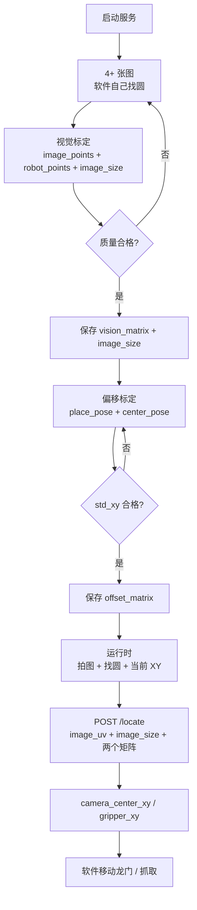

# 龙门相机抓取模块说明（Pick API）

> 面向同事的模块介绍：解决什么问题、现场怎么标定、三个接口怎么调、debug 产物在哪里、边界是什么。
>
> 接口速查：[`PICK_API.md`](PICK_API.md)
>
> 代码入口：[`measure/pick_api.py`](../measure/pick_api.py)、[`measure_api/pick_server.py`](pick_server.py)

---

## 0. 一句话

三轴龙门上，相机和夹爪不在同一个点。这个模块通过两次标定，把图像里的目标位置换算成两个机械坐标：

- `camera_center_xy`：把**相机中心**移到目标上时，法兰应该在哪；
- `gripper_xy`：把**夹爪**移到目标上时，法兰应该在哪。

每次标定只返回一个 **3×3 齐次矩阵**：

- 视觉标定返回 `vision_matrix`；
- 偏移标定返回 `offset_matrix`。

软件保存这两个矩阵，定位时把它们和当前法兰 XY 一起传给 `/locate`。服务端**不保存配方**，不直接和机器人/PLC 通信，也不处理 Z。

**服务端不找圆，也不收图。** 圆心由软件自己的找圆工具给出（v1 测量接口、v2 `measurements.circles`、或设备自带配方），本模块只接收 `(u, v)` 与图像宽高，全部接口都是 JSON。

---

## 1. 系统组成

| 文件 | 作用 |
|---|---|
| `measure/pick_api.py` | 纯计算核心：`GantryPick`、`TargetLocation`、矩阵校验（不含找圆） |
| `measure/pick_artifacts.py` | debug run 目录、点表、manifest、ZIP、保留清理 |
| `measure_api/pick_server.py` | FastAPI 服务：3 个业务接口 + debug 开关 + 产物读取 |
| `measure/pick_replay.py` | 离线复现 CLI |
| `measure_api/PICK_API.md` | 精简接口契约 |
| `tests/test_pick_api.py` | 核心矩阵/定位测试 |
| `tests/test_pick_artifacts.py` | 落盘/标注测试 |
| `tests/test_pick_server.py` | HTTP 接口测试 |

服务是**无状态**的：没有 `pick_recipe.json`，也没有 `/status`。

---

## 2. 坐标与矩阵约定

### 2.1 基本约定

| 项目 | 约定 |
|---|---|
| 图像坐标 | `(u, v) = (col, row)`，像素 |
| 机械坐标 | `(X, Y)`，单位与控制器一致，通常 mm |
| Z 轴 | **完全忽略**；请求带 3 个数也只取前两个 |
| 图像中心 | `((W-1)/2, (H-1)/2)`，标定和定位共用 |
| 找圆 | **由调用方负责**；服务只收圆心 `(u, v)` 与 `image_size` |
| 点校验 | 点必须落在 `[0,W-1]×[0,H-1]` 内，越界按 `400 point_out_of_image` 拒绝 |
| 分辨率 | 矩阵只在标定分辨率下有效；换分辨率/裁剪要重标 |

### 2.2 视觉矩阵

```text
V = [[a00, a01, b0],
     [a10, a11, b1],
     [0,   0,   1 ]]
```

`/locate` 只用左上 2×2：

```text
A = V[:2, :2]
delta = A @ (image_centre - target_uv)
camera_center_xy = robot_pose + delta
```

> **第三列 `b` 只对本次标定目标所在位置成立，`/locate` 不使用它。**
> 它保留在矩阵里只为完整存档；不要用 `V @ [u,v,1]` 当任意目标的绝对坐标。

### 2.3 偏移矩阵

```text
O = [[1, 0, dx],
     [0, 1, dy],
     [0, 0, 1 ]]
```

```text
gripper_xy = camera_center_xy + (dx, dy)
```

左上 2×2 也可以是拟合出的线性部分（旋转/尺度/剪切），此时按完整矩阵应用：

```text
gripper_xy = O @ [camera_center_xy, 1]
```

`/locate` 接受一般仿射；只拒绝奇异、镜像、末行错误和尺度异常（|σ| 超出 [0.5, 2]）的矩阵。

---

## 3. 端到端流程



### 3.1 视觉标定

1. 标定圆固定在工位上，不要动；
2. 移动相机，让标定圆出现在画面四角（建议 4 角 + 中心，共 5 点；产线建议 7~9 点）；
3. 每个位置拍一张图，记录当时的法兰 XY；
4. **用软件自己的找圆工具**在每张图上取圆心 `(u, v)`，同时记下图像宽高；
5. 调 `/calibrate/vision`，保存返回的 `matrix`、`image_size`、`rms_px`；
6. 质量不合格时接口返回 422，不会给矩阵；重新拍，直到拿到矩阵。

### 3.2 偏移标定

1. 夹爪抓起标定物，放到工位上，保持不动，记录 `place_pose`；
2. 移动龙门，让相机看到目标；
3. 把目标移到画面中心：
   - 手动微调，或
   - 先用视觉矩阵调 `/locate` 拿 `camera_center_xy`，移动过去，再拍一张确认；
4. 记录实际 `center_pose`；
5. 调 `/calibrate/offset`，保存返回的 `matrix`；
6. 建议换 3~5 个位置重复；只做平移时看平移列 `dx/dy` 是否稳定，需要拟合仿射时看 `effective_model` 与 `rms_mm`。

平移模型下 `offset = place_pose − center_pose`，**加**到相机居中位姿上：

```text
gripper_xy = camera_center_xy + offset_xy
```

多点拟合后统一按矩阵应用：

```text
gripper_xy = matrix @ [camera_center_xy, 1]
```

`model=auto`（默认）只有在平移解释不了样本时才启用仿射；只给一对样本时仍然是纯平移。

### 3.3 运行时定位

1. 软件拍照，用找圆工具拿到圆心 `(u, v)`；
2. 读拍照时的法兰 `(X, Y)`；
3. 带上 `image_uv`、`image_size` 和保存的两个矩阵调 `/locate`；
4. 拿 `gripper_xy` 直接抓，或先移动到 `camera_center_xy` 再看一次；
5. Z 轴由软件自己控制。

软件侧伪代码：

```python
resp = POST /api/v1/locate          # image + robot_pose + vision_matrix + offset_matrix
if not resp["ok"]:
    raise RuntimeError(resp["error"])

move_to(resp["gripper_xy"])
# Z 由软件按工艺设置
```

---

## 4. 接口 1：视觉标定

`POST /api/v1/calibrate/vision`，JSON：

| 字段 | 类型 | 必填 | 说明 |
|---|---|---|---|
| `image_size` | `[w, h]` | 是 | 取点时的图像宽高 |
| `image_points` | `[[u,v], ...]` | 是 | 找圆结果，4 个以上，顺序与机械点一一对应 |
| `robot_points` | `[[x,y], ...]` | 是 | 与 `image_points` 等长；带 Z 也只取 XY |
| `principal_point` | `[u0,v0]` | 否 | 默认图像中心 |
| `confidences` | `[...]` | 否 | 与点数等长，只进诊断 |

```bash
curl -X POST http://127.0.0.1:8100/api/v1/calibrate/vision \
  -H 'content-type: application/json' \
  -d '{
        "image_size": [5472, 3648],
        "image_points": [[2458.040, 2279.497], [3206.108, 1334.445],
                         [3308.557, 2183.056], [2356.346, 1431.227]],
        "robot_points": [[10.928, 321.647], [20.928, 331.647],
                         [10.928, 331.647], [20.928, 321.647]]
      }'
```

响应：

```json
{
  "ok": true,
  "matrix": [
    [-0.001321362642334, -0.011627365736710, 40.681749989616],
    [ 0.011604128501497, -0.001396038632585, 296.3037814102695],
    [ 0.0,                0.0,                1.0]
  ],
  "rms_px": 0.207,
  "rms_mm": 0.00242,
  "principal_point": [2735.5, 1823.5],
  "image_size": [5472, 3648],
  "warnings": ["low_image_coverage"]
}
```

- 服务看不到图，`rms_px` / `rms_mm` / `warnings` 是唯一的质量信号，请和矩阵一起存；
- 标定质量不合格：422 `calibration_invalid`，不返回矩阵；
- 机械点共线/退化：422 `calibration_failed`；
- 点数不等：400 `point_count_mismatch`；少于 4 点：400 `bad_request`；
- 坐标越界：400 `point_out_of_image`（多半是把 `(row, col)` 当成了 `(u, v)`）；
- debug 开时只额外返回 `run_id`。

---

## 5. 接口 2：偏移标定

`POST /api/v1/calibrate/offset`，JSON：

```json
{
  "samples": [
    {"place_pose": [118.0, 89.0], "center_pose": [110.0, 85.0]}
  ],
  "model": "auto"
}
```

响应：

```json
{
  "ok": true,
  "matrix": [
    [1.0, 0.0, 8.0],
    [0.0, 1.0, 4.0],
    [0.0, 0.0, 1.0]
  ],
  "offset_xy": [8.0, 4.0],
  "std_xy": [0.0, 0.0],
  "num_samples": 1,
  "model": "auto",
  "effective_model": "translation",
  "rms_mm": 0.0,
  "max_mm": 0.0,
  "condition": 1.0,
  "rotation_deg": 0.0,
  "scale": 1.0,
  "shear": 0.0,
  "convention": "grasp_pose = matrix @ camera_centred_pose",
  "warnings": []
}
```

- `samples` 至少 1 组；做平移建议 3~5 组，做仿射建议 ≥6 组（4 组只够勉强验证）；
- `place_pose`：夹爪放下目标时的法兰 XY；
- `center_pose`：相机对准目标时的法兰 XY；
- `model`：`auto`（默认，平移够用就不拟合仿射）/ `translation` / `affine`；
- 平移模型下样本互相矛盾（每轴 `std_xy` 超过 0.5 mm）：422 `offset_invalid`，不返回矩阵。
  典型场景是把「没有真正移动」的 place/center 占位样本混进来，均值会偏几十毫米；
- `effective_model=affine` 时看 `rms_mm` 和 `rotation_deg`/`scale`/`shear`；残差超限或旋转 >15°、
  尺度变化 >2%、镜像都会 422；
- debug 开时只额外返回 `run_id`。

---

## 6. 接口 3：定位

`POST /api/v1/locate`，JSON：

| 字段 | 类型 | 必填 | 说明 |
|---|---|---|---|
| `image_size` | `[w, h]` | 是 | 必须和标定时一致 |
| `image_uv` | `[u, v]` | 是 | 找圆结果 |
| `robot_pose` | `[x, y]` | 是 | 拍照时法兰 XY |
| `vision_matrix` | 3×3 | 是 | 视觉标定返回的矩阵 |
| `offset_matrix` | 3×3 | 否 | 偏移标定返回的矩阵 |
| `radius_px` | float | 否 | 只写进 debug 产物，便于对账 |

```bash
curl -X POST http://127.0.0.1:8100/api/v1/locate \
  -H 'content-type: application/json' \
  -d '{
        "image_size": [5472, 3648],
        "image_uv": [2836.937, 1806.012],
        "robot_pose": [15.928, 326.647],
        "vision_matrix": [[-0.001321362642334, -0.011627365736710, 40.681749989616],
                          [ 0.011604128501497, -0.001396038632585, 296.3037814102695],
                          [0, 0, 1]],
        "offset_matrix": [[1, 0, 123.67973454793294],
                          [0, 1, 1.4771626790364583],
                          [0, 0, 1]]
      }'
```

响应：

```json
{
  "ok": true,
  "camera_center_xy": [15.8587, 325.4455],
  "gripper_xy": [139.5384, 326.9227],
  "delta_xy": [-0.0693, -1.2015],
  "gripper_delta_xy": [123.6106, 2.7553]
}
```

- `delta_xy = A @ (image_centre - image_uv)`，只负责把相机对准，不含偏移；
- 一步走到抓取位用 `gripper_delta_xy = gripper_xy - robot_pose`；仿射偏移下不能再拿
  `delta_xy + offset` 相加；
- 不传 `offset_matrix`：`gripper_xy`/`gripper_delta_xy` 为 `null`，`camera_center_xy` 仍可用；
- 矩阵不是 3×3、最后一行不对、奇异、镜像、尺度异常：400 `bad_matrix`；
- 点越界：400 `point_out_of_image`；
- 找不到圆不再是本接口的错误：找圆失败由软件自己处理；
- debug 开时只额外返回 `run_id`。

---

## 7. Debug 与产物

全局开关：

```http
GET /api/v1/debug
PUT /api/v1/debug   {"enabled": true}
```

- 开：校准/定位生成 `data/pick_runs/<run_id>/`；
- 关：不生成任何 run 目录；
- 响应只多一个 `run_id`，不返回图片 URL；
- 开关只在内存，重启回到 `PICK_DEBUG`。

run 目录（不含图片）：

```text
data/pick_runs/<run_id>/
├── manifest.json          # run 元信息、文件索引、环境版本
├── inputs.json            # 原始入参：image_size、点、位姿、两个矩阵
├── result.json            # 矩阵/坐标 + 诊断
├── points.json            # 视觉标定：每个点的 u,v,x,y,残差
└── README.txt
```

服务不再解码图片，所以没有 `images/` 和 `overview.jpg`。旧版本留下的带图 run 仍然
能列表、能打包、也能用 `pick_replay` 复现。

读取：

| 方法 | 路径 | 说明 |
|---|---|---|
| `GET` | `/api/v1/runs?limit=20` | 最近 run |
| `GET` | `/api/v1/runs/{run_id}` | manifest，含点表/文件索引 |
| `GET` | `/api/v1/runs/{run_id}/archive` | 下载 ZIP |
| `GET` | `/files/{run_id}/...` | 产物 JSON（旧 run 仍可读图片） |

复现：

```bash
python -m measure.pick_replay data/pick_runs/<run_id>
```

CLI 会用 `inputs.json` 里的坐标重算矩阵/坐标，并和 `result.json` 对比；旧的带图 run 会先重新找圆。

---

## 8. 误差与边界

### 8.1 适用前提

- 三轴直角坐标龙门，法兰姿态固定；
- 相机光轴接近竖直，镜头畸变小（或先做去畸变）；
- 标定物和实际瓶口特征高度接近；
- 相机、夹爪刚性安装，机械改动后重新标定；
- 一张图一个圆形目标；
- 机械坐标单位统一（建议 mm）；
- 图像分辨率/裁剪与标定时一致。

### 8.2 主要误差源

| 来源 | 量级 | 说明 |
|---|---|---|
| 圆心检测 | 0.03~2 px | **由调用方的找圆工具决定**，本模块不做门控 |
| 仿射拟合 | 0.05~0.3 px | 建议 7~9 点、覆盖全视野 |
| 镜头畸变 | 1~5 px（边缘） | 先做内参去畸变，或缩小视野 |
| 相机倾斜 | 0.05~0.2 mm | 倾斜时严格来说是单应，仿射只是局部近似 |
| 机械重复性 | 0.02~0.2 mm | 双向接近、多点平均 |
| 目标高度/视差 | 0.1~1 mm | 标定物与目标等高，或做高度补偿 |
| 相机 Z 变化 | 尺度按比例变 | 视觉 Z 固定，或标定 `H` 后补偿 |

经验值：目标等高、Z 固定、重复性 0.05 mm 时，抓取精度做到 **0.1~0.3 mm** 是合理的。

### 8.3 不适用的情况

- 关节臂变姿态：偏移在基座系里会跟着旋转，不能当常向量；
- 相机拍照 Z 和放料 Z 差异大，且不是三轴龙门；
- 目标不是圆，或一张图有多个同类目标且需要区分；
- 需要输出物理目标 XY，但不知道相机安装偏移 `K`。

---

## 9. 常见问题

**Q：怎么判断这次标定好不好？**<br>
A：看响应里的 `rms_px` / `rms_mm` / `warnings`。`rms_px` 明显变大就重标；质量不合格直接 422。debug 打开时可用 `run_id` 查 `points.json` 看每个点的残差。

**Q：为什么视觉矩阵的 `b` 和定位结果对不上？**<br>
A：`/locate` 只用左上 2×2 的 `A`，`b` 只对本次标定目标位置成立，不能跨位置当绝对坐标。

**Q：`gripper_xy` 为什么是 `null`？**<br>
A：没传 `offset_matrix`。偏移标定完成后把矩阵一起传入即可。

**Q：为什么接口不再收图？**<br>
A：找圆是设备侧已有能力（v1、v2 或自家配方），放进服务会造成两份找圆逻辑和两套调参。现在服务只做矩阵与坐标换算，找圆失败由软件自己判。

**Q：圆心传 `(row, col)` 会怎样？**<br>
A：多半被 `400 point_out_of_image` 拦下；如果图像恰好接近正方形，可能漏过并算出错误矩阵，所以必须按 `(u, v) = (col, row)` 传。

**Q：换分辨率/裁剪后结果不对？**<br>
A：矩阵只在标定分辨率下有效；重新标定。

**Q：服务重启后标定还在吗？**<br>
A：服务端不存配方。矩阵由软件保存，重启后继续传参即可。

**Q：debug 开了，为什么没有 run 目录？**<br>
A：先确认 `GET /debug` 是 `true`；400 类请求不创建 run，422 类处理失败会创建。

**Q：多瓶型怎么管理？**<br>
A：软件自己保存多套 `vision_matrix` / `offset_matrix`，按产品切换传参即可；服务端无状态。

---

## 10. 测试与代码入口

```bash
# 启动
python -m measure_api.pick_server

# 本模块测试
pytest tests/test_pick_*.py -q

# 找圆 + 标定相关
pytest tests/test_pick_api.py tests/test_pick_artifacts.py \
       tests/test_pick_server.py tests/test_circle_locator.py \
       tests/test_robot_calibration.py -q

# 离线复现
python -m measure.pick_replay data/pick_runs/<run_id>
```

代码阅读顺序：

1. `measure/pick_api.py`：矩阵校验、`GantryPick.locate` 公式；
2. `measure_api/pick_server.py`：三个路由和 debug 记录；
3. `measure/pick_artifacts.py`：run 目录和标注；
4. `measure/pick_replay.py`：离线复现。

---

## 11. 上线前检查清单

- [ ] 软件找圆可用，并统一按 `(u, v) = (col, row)` 传坐标；
- [ ] 视觉标定拿到 3×3 矩阵，`rms_px` 在 0.5 px 以内；
- [ ] 偏移标定拿到 3×3 矩阵，`std_xy` 在 0.5 mm 以内；
- [ ] 用新图调 `/locate`，`gripper_xy` 与手动测量一致；
- [ ] 软件已保存两套矩阵并能正确传参；
- [ ] 生产时 `GET /debug` 为 `false`；
- [ ] 换分辨率/裁剪后重新标定。
